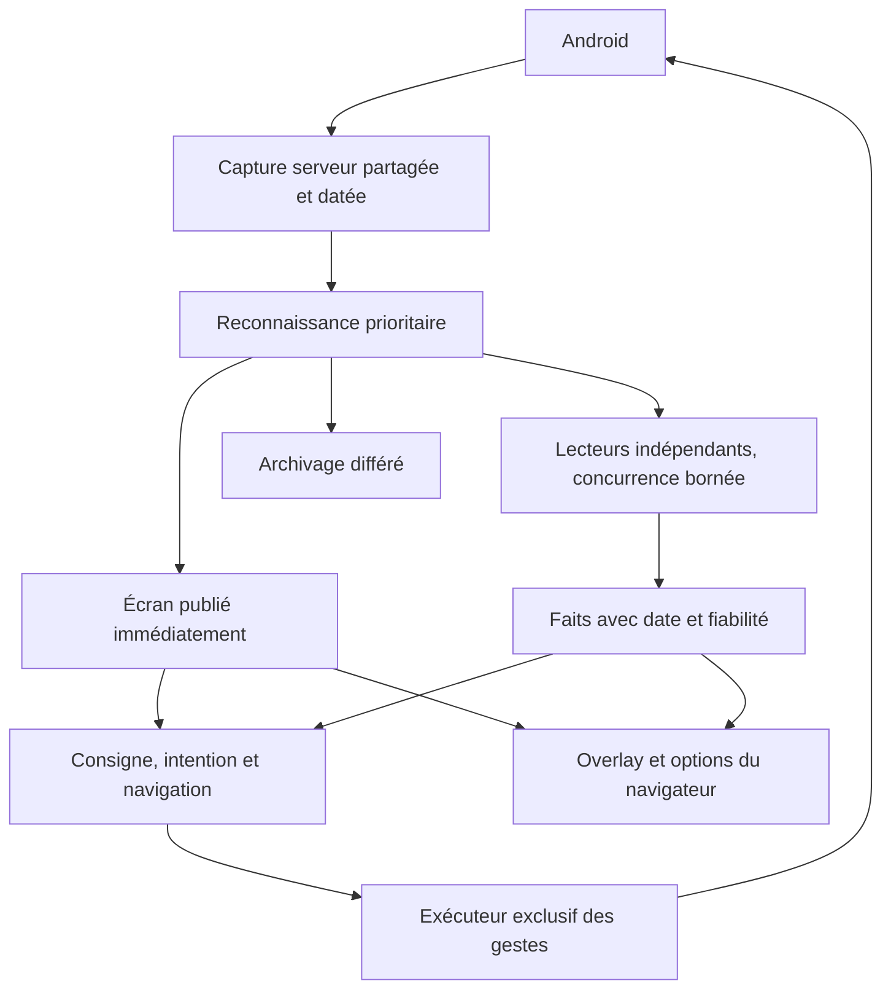

# Observation et contrôle du Cloud Phone

Le serveur possède les faits, les calculs métier, les consignes et les décisions.
La webapp affiche le flux et ces états, présente les options et transmet les
actions humaines. Son interpolation du compteur de cubes est une présentation
d'un modèle daté du serveur : elle ne crée pas une nouvelle mesure.

## Circuit d'observation

Le flux vidéo WebRTC affiché dans le navigateur et les captures analysées par
le serveur sont deux circuits distincts. L'observateur serveur continue lorsque
la page est fermée. Un lecteur lent n'empêche pas de publier l'écran reconnu.

Responsabilités actuelles :

| Composant | Responsabilité et contrat |
|---|---|
| Gateway `Screenshots` | Une acquisition physique à la fois ; partage des demandes concurrentes ; invalidation sur input ; date de début d'acquisition conservée. |
| Gateway `Analysis` | Une voie dédiée à la reconnaissance et une voie de deux workers pour les autres analyses ; capacité retenue jusqu'à la fin réelle du travail, même si l'appelant est annulé. |
| `features/game.py` | Façade des routes et de l’API consommée par les fonctionnalités ; assemble les réponses sans dupliquer les faits. |
| `game_readers.ReaderRegistry` | Reconnaissance et registre des lecteurs ; fonctions de lecture sans stockage ni gestes. |
| `game_facts.FactStore` | Faits datés, persistance, invalidation et journal des changements. |
| `game_observation.ObservationPipeline` | Identité des captures, analyses bornées, lectures attendues sur une image précise et archivage différé. |
| `game_observation.CaptureProducer` | Cadence de capture et sondes du processus/premier plan. |
| `mode_setup.SetupEvidence` | Blocages, reçu de cible et résultat lié à la révision, aux inputs et à la génération du jeu. |
| `features/game_rules.py` | Schéma, dépendances des lecteurs, fraîcheur, persistance, valeurs historiques et absence de preuve actuelle. |
| `features/mode.py` | Consigne durable, échéance, configuration acceptée, demande d'application et résultat observé. Un accusé de réception n'est pas une réussite en jeu. |
| Navigation et fonctionnalités | Choix et vérification des gestes selon les lecteurs et le garde de navigation ; bail partagé exclusif ; inputs humains prioritaires. |
| Trace et debug | Captures, annotations, identité détectée et identité signalée. Un signalement humain est une preuve à examiner, pas une nouvelle règle de clic automatiquement autorisée. |
| Modules `page_*` | Rendu, formulaires et commandes explicites. Pas de moteur autonome de farming dans la webapp. |

## Construction et dépendances

`gateway.py` construit les composants explicitement, avec une seule instance de
chaque module par plugin. Les lecteurs ne connaissent ni le mode ni le stockage.
Le registre de faits ne connaît pas la navigation. Les preuves de setup ne
pilotent aucun geste : elles valident seulement la portée d’un résultat fourni
par l’exécuteur. Les signatures des constructeurs rendent ces dépendances
visibles ; aucun chargement caché ni bus global n’est nécessaire.

## Invariants

Chaque résultat reste lié à sa capture et à la génération de la session de jeu.
Un calcul ancien ne remplace pas une observation plus récente, y compris une
observation récente illisible. Une valeur historique conservée ne prouve pas
qu'elle est toujours vraie. Les lectures requises par une action sont attendues
explicitement sur la capture concernée ; la publication rapide de l'écran ne
certifie pas que ses autres lecteurs ont terminé.

Les lectures peuvent être concurrentes ; les gestes ne le sont pas. Chaque
opération vérifie sa précondition, effectue un geste sous le bail, puis contrôle
son résultat sur une nouvelle capture. Pour la gravure, cela comprend l'identité
de l'arme, les cellules occupées et les cadenas. Un échec conserve le besoin de
récupération et ne devient pas silencieusement un état « prêt ».

La cadence nominale de capture est de 0,5 seconde après activité humaine et de
1,5 seconde quand le jeu au premier plan est stable. La durée réelle de capture
s'ajoute à cet intervalle. Hors jeu, les sondes ralentissent. Les lecteurs gardent
leurs propres intervalles : capturer fréquemment n'impose pas tous les OCR à
chaque image. Ces valeurs sont des paramètres d'exécution, pas une mesure de
latence garantie.

## Mesure et validation

`/game.observation` expose la fraîcheur du dernier écran, les durées d'acquisition,
de reconnaissance et des lecteurs, les travaux en cours, les files et les
abandons. Les statistiques du gateway exposent les acquisitions partagées et
les attentes des voies d'analyse. Un abandon de capture remplacée par une plus
récente est normal ; une erreur de lecteur ou une file qui ne se vide pas doit
être investiguée.

La validation produit utilise Agent mode et la partie réelle : vérifier l'écran
avant/après, la mise à jour des faits, le délai observé, l'absence d'action
concurrente et le retour à la consigne. Une compilation ou un test automatique
n'est pas une preuve de ce parcours. Les exemples bruts restent dans l'archive
privée ; seuls des crops revus et sans données personnelles servent de fixtures.

## Travail restant explicite

Le moteur de navigation n'est pas encore un planificateur unique : mode,
surveillance, rafraîchissement et setup ont encore leurs coordinateurs. Le bail
sérialise leurs gestes, mais leur unification et la publication du chemin complet
restent ouvertes. Toutes les annotations ne sont pas consommées par les lecteurs.
Certaines fonctionnalités récupèrent encore l’API de jeu via `ports.game` :
l’ordre de construction reste explicite dans `gateway.py`, et cette dépendance
sera à injecter directement lors de leur prochaine extraction.
Les champs sans lecteur restent sans lecteur ; cette réorganisation ne remplace
pas leur calibration. La validation de chaque demande reste suivie dans
`SESSION-REQUESTS-AUDIT.md` et `TODO.md`.
