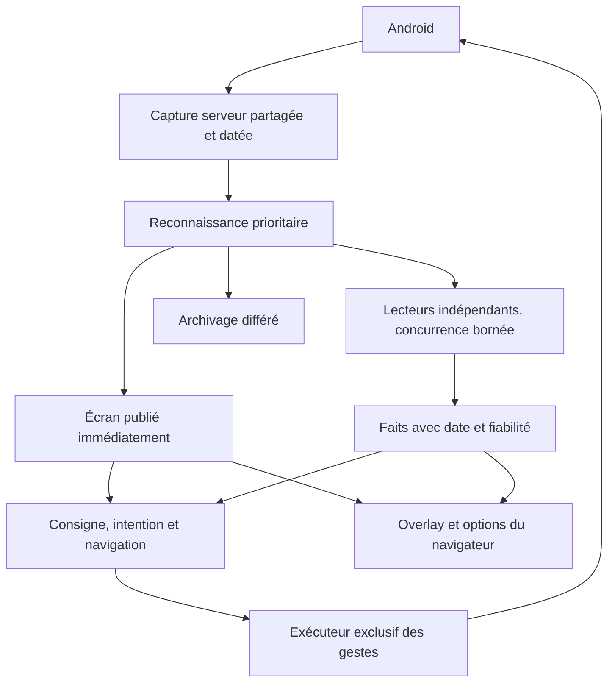

# Observation et contrôle du Cloud Phone

Le serveur possède les faits, les calculs métier, les consignes et les décisions.
La webapp affiche le flux et ces états, présente les options et transmet les
actions humaines. Son interpolation du compteur de cubes est une présentation
d'un modèle daté du serveur : elle ne crée pas une nouvelle mesure.

## Circuit d'observation

Le flux vidéo WebRTC affiché dans le navigateur et les captures analysées par
le serveur sont deux circuits distincts. L'observateur serveur continue lorsque
la page est fermée. Un lecteur lent n'empêche pas de publier l'écran reconnu.

Responsabilités actuelles :

| Composant | Responsabilité et contrat |
|---|---|
| Gateway `Screenshots` | Une acquisition physique à la fois ; partage des demandes concurrentes ; invalidation sur input ; date de début d'acquisition conservée. |
| Gateway `Analysis` | Une voie dédiée à la reconnaissance et une voie de deux workers pour les autres analyses ; capacité retenue jusqu'à la fin réelle du travail, même si l'appelant est annulé. |
| `features/game.py` | Façade des routes et de l’API consommée par les fonctionnalités ; assemble les réponses sans dupliquer les faits. |
| `game_readers.ReaderRegistry` | Reconnaissance et registre des lecteurs ; fonctions de lecture sans stockage ni gestes. |
| `game_facts.FactStore` | Faits datés, persistance, invalidation et journal des changements. |
| `game_observation.ObservationPipeline` | Identité des captures, analyses bornées, lectures attendues sur une image précise et archivage différé. |
| `game_observation.CaptureProducer` | Cadence de capture et sondes du processus/premier plan. |
| `mode_setup.SetupEvidence` | Blocages, reçu de cible et résultat lié à la révision, aux inputs et à la génération du jeu. |
| `features/game_rules.py` | Schéma, dépendances des lecteurs, fraîcheur, persistance, valeurs historiques et absence de preuve actuelle. |
| `features/mode.py` | Consigne durable, échéance, configuration acceptée, demande d'application et résultat observé. Un accusé de réception n'est pas une réussite en jeu. |
| Navigation et fonctionnalités | Choix et vérification des gestes selon les lecteurs et le garde de navigation ; bail partagé exclusif ; inputs humains prioritaires. |
| Trace et debug | Captures, annotations, identité détectée et identité signalée. Un signalement humain est une preuve à examiner, pas une nouvelle règle de clic automatiquement autorisée. |
| Modules `page_*` | Rendu, formulaires et commandes explicites. Pas de moteur autonome de farming dans la webapp. |

## Construction et dépendances

`gateway.py` construit les composants explicitement et met en cache les modules
qu'il charge pendant cette composition. Les lecteurs ne connaissent ni le mode ni le stockage.
Le registre de faits ne connaît pas la navigation. Les preuves de setup ne
pilotent aucun geste : elles valident seulement la portée d’un résultat fourni
par l’exécuteur. Les signatures des constructeurs rendent ces dépendances
visibles. Certains lecteurs historiques chargent encore eux-mêmes leurs modules
utilitaires : ce cache ne garantit donc pas une instance unique de tous les
modules du plugin. Leur injection explicite reste à terminer.

La publication d’un setup complet a un seul point de validation dans le mode :
`publish_setup` accepte le reçu, publie l’état puis notifie les observateurs,
sans attente entre ces étapes. L’entrée de mode et la confirmation d’une reprise
utilisent ce même chemin. Le watchdog relaie cet événement pour ses abonnés ;
l’historique des taux écoute uniquement le mode. Une preuve refusée ne publie
ni état prêt ni événement de réussite. Cette extraction ne centralise pas encore
la planification ni les gestes.

## Invariants

Chaque résultat reste lié à sa capture et à la génération de la session de jeu.
Un calcul ancien ne remplace pas une observation plus récente, y compris une
observation récente illisible. Une valeur historique conservée ne prouve pas
qu'elle est toujours vraie. Les lectures requises par une action sont attendues
explicitement sur la capture concernée ; la publication rapide de l'écran ne
certifie pas que ses autres lecteurs ont terminé.

Les lectures peuvent être concurrentes ; les gestes ne le sont pas. Chaque
opération vérifie sa précondition, effectue un geste sous le bail, puis contrôle
son résultat sur une nouvelle capture. Pour la gravure, cela comprend l'identité
de l'arme, les cellules occupées et les cadenas. Un échec conserve le besoin de
récupération et ne devient pas silencieusement un état « prêt ».

La reprise utilise d'abord la recette durable liée à l'arme reconnue. Un ancien
enregistrement sans recette ne suffit pas à inventer un placement : seule une
cible explicitement fournie, avec la même arme et la même variante, peut le
compléter. Une recette durable existante reste prioritaire. Une réparation
réussie de la gravure ne prouve pas que le stage et le preset de combat sont
corrects ; ces résultats doivent rester distincts dans les options.

Le support géométrique d'une variante et l'autorisation d'exécuter une action
sont également distincts. Un preset déjà correct ne nécessite aucun changement.
Un écart fraîchement lu face à une action suspendue produit un refus explicite
avant d'ouvrir Battle Settings ; si l'écart est déjà lisible au départ, il est
signalé avant le changement de stage. La réparation d'une gravure incomplète
reste prioritaire pour rétablir son bonus de complétion.

Un refus de politique connu est un résultat typé non réessayable, distinct d'un
échec temporaire de lecture. Le mode termine cette tentative immédiatement. La
surveillance conserve la raison pour la cible, l'activité utilisateur et la
politique concernées, sans produire un compte à rebours de réparation. Un
changement de contexte ou une nouvelle lecture du preset attendu autorise une
réévaluation ; une gravure en attente reste toujours réparable. Le bouton
d'application explicite permet également un nouveau contrôle sans modifier la
cible ni les permissions.

La cadence nominale de capture est de 0,5 seconde après activité humaine et de
1,5 seconde quand le jeu au premier plan est stable. La durée réelle de capture
s'ajoute à cet intervalle. Hors jeu, les sondes ralentissent. Les lecteurs gardent
leurs propres intervalles : capturer fréquemment n'impose pas tous les OCR à
chaque image. Ces valeurs sont des paramètres d'exécution, pas une mesure de
latence garantie.

## Mesure et validation

`/game.observation` expose la fraîcheur du dernier écran, les durées d'acquisition,
de reconnaissance et des lecteurs, les travaux en cours, les files et les
abandons. Les statistiques du gateway exposent les acquisitions partagées et
les attentes des voies d'analyse. Un abandon de capture remplacée par une plus
récente est normal ; une erreur de lecteur ou une file qui ne se vide pas doit
être investiguée.

La validation produit utilise Agent mode et la partie réelle : vérifier l'écran
avant/après, la mise à jour des faits, le délai observé, l'absence d'action
concurrente et le retour à la consigne. Une compilation ou un test automatique
n'est pas une preuve de ce parcours. Les exemples bruts restent dans l'archive
privée ; seuls des crops revus et sans données personnelles servent de fixtures.

## Travail restant explicite

### Frontières cibles et migration

La direction retenue est une refonte ciblée de l'orchestration par extractions
progressives, en conservant les captures, lecteurs calibrés, faits et gardes
déjà éprouvés. Les contrats ci-dessous sont la cible ; ils ne décrivent pas tous
des composants déjà extraits.

| Responsabilité | Produit | Ne décide pas |
|---|---|---|
| Capture | Image, identifiant, date d'acquisition, génération du jeu | Quel mode appliquer ou quel bouton toucher |
| Identité d'écran | Écran reconnu, confiance, repères utilisés ; inconnu explicite | Quel trajet suivre |
| État local de l'écran | Panneaux, contrôles dépliés, viewport du combat, défilement réellement observé ; état vide si non pertinent, inconnu si illisible | Que deux positions de scroll sont forcément le même contenu |
| Éléments interactifs | Zones et gestes visibles, identité, préconditions et rôle navigation/action | Qu'un bouton reconnu est autorisé |
| Lecture de l'état courant | Arme/preset/stage sélectionnés, placement, verrous et autres faits temporaires | Qu'un ancien fait certifie la situation présente |
| Lecture des ressources | Soldes observés, provenance et fraîcheur indépendantes | Les débits et projections |
| Lecture de progression | Avancement durable du compte, bornes et niveaux observés | Les sélections temporaires |
| Calculs dérivés | Débits, estimations et comparaisons issus de faits datés | De nouvelles mesures inventées |
| Gestion des modes | Mode choisi, mode par défaut, échéance, transition et annulation de la génération précédente | Des coordonnées ou des séquences de clics |
| Politique de chaque mode | Objectif à atteindre et maintenir, priorités, demandes de rafraîchissement | Les gestes exécutés directement |
| Planification | Chemin applicable entre états d'écran, préconditions, coût et preuve attendue après chaque étape | Un trajet supposé lorsqu'une transition manque |
| Exécution exclusive | Un geste autorisé, puis observation de son résultat ; interruption à chaque frontière | La réussite à partir du seul envoi du geste |
| Reprise et supervision | Échec typé et daté, contexte, prochain essai borné, alerte concise | Une seconde boucle concurrente de navigation |
| Debug et apprentissage | Captures avant/après, clics et glissements, retours audio/visuels, version exacte de l'overlay | Une permission de clic dérivée automatiquement d'un signalement |
| Présentation | Flux, overlay, options et états publiés, avec noms d'affichage | La vérité métier ou les décisions autonomes |

Les scans d'état courant, de progression et de ressources consomment le même
instantané daté ; ils ne prennent pas chacun leur propre capture et ne dépendent
pas de l'achèvement des autres lecteurs. Une information absente est inconnue,
pas une valeur par défaut qui pourrait autoriser un geste.

La cible commune de contrôle comprend le mode et sa génération, la configuration
acceptée et sa révision, la session de jeu, l'activité humaine, l'objectif de
l'opération et ses preuves attendues. Le contexte d'un échec distingue la cible
et la capacité de navigation reconnue : un ancien délai de reprise ne doit pas
être hérité aveuglément par une nouvelle situation. Les échecs de lecture,
préconditions non applicables et opérations annulées ont des politiques
différentes ; une simple preuve périodique vieillie n'est pas un échec rouge.

Soul Weapon/Engraving reste une transaction métier : enregistrer l'intention
durable avant Equip, appliquer la gravure immédiatement après, puis vérifier
identité, meilleures pièces et huit verrous. Le planificateur peut conduire à
cette transaction mais ne l'intercale pas avec une excursion de ressources.
Un changement de mode ou un input révoque les gestes suivants et les résultats
anciens ; l'observation continue pendant la pause.

Ordre de migration :

1. Extraire le contexte et les résultats des opérations, sans changer leurs
   autorisations ; supprimer les replis implicites vers un autre écran.
2. Publier l'état local et les éléments interactifs dans un instantané commun,
   en réutilisant les lecteurs existants et leurs preuves.
3. Isoler les objectifs de chaque mode, puis migrer un trajet calibré à la fois
   vers le planificateur et l'exécuteur communs ; comparer le parcours annoncé
   aux captures avant/après.
4. Retirer les anciens coordinateurs seulement quand leurs parcours et reprises
   ont été exercés en production ; conserver les régressions reproduites comme
   corpus de validation privé.

La performance se mesure sur toute la chaîne : input/changement visuel → image
disponible → identité publiée → faits requis → décision → résultat observé.
Mesurer p50/p95, âge des données, files et abandons avant d'ajouter des workers.
Prioriser reconnaissance et lectures nécessaires au prochain geste, puis les
lectures de fond ; différer l'archivage. Les files remplacent une image dépassée
par la plus récente plutôt que d'accumuler du retard. Une lecture exacte requise
par une transaction conserve toutefois son identité de capture. Les lecteurs
peuvent être concurrents ; il n'existe qu'un exécuteur des actions sur le jeu.

Le moteur de navigation n'est pas encore un planificateur unique : mode,
surveillance, rafraîchissement et setup ont encore leurs coordinateurs. Le bail
sérialise leurs gestes, mais leur unification et la publication du chemin complet
restent ouvertes. Toutes les annotations ne sont pas consommées par les lecteurs.
Certaines fonctionnalités récupèrent encore l’API de jeu via `ports.game` :
l’ordre de construction reste explicite dans `gateway.py`, et cette dépendance
sera à injecter directement lors de leur prochaine extraction.
Les champs sans lecteur restent sans lecteur ; cette réorganisation ne remplace
pas leur calibration. La validation de chaque demande reste suivie dans
`SESSION-REQUESTS-AUDIT.md` et `TODO.md`.
